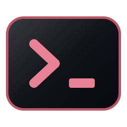
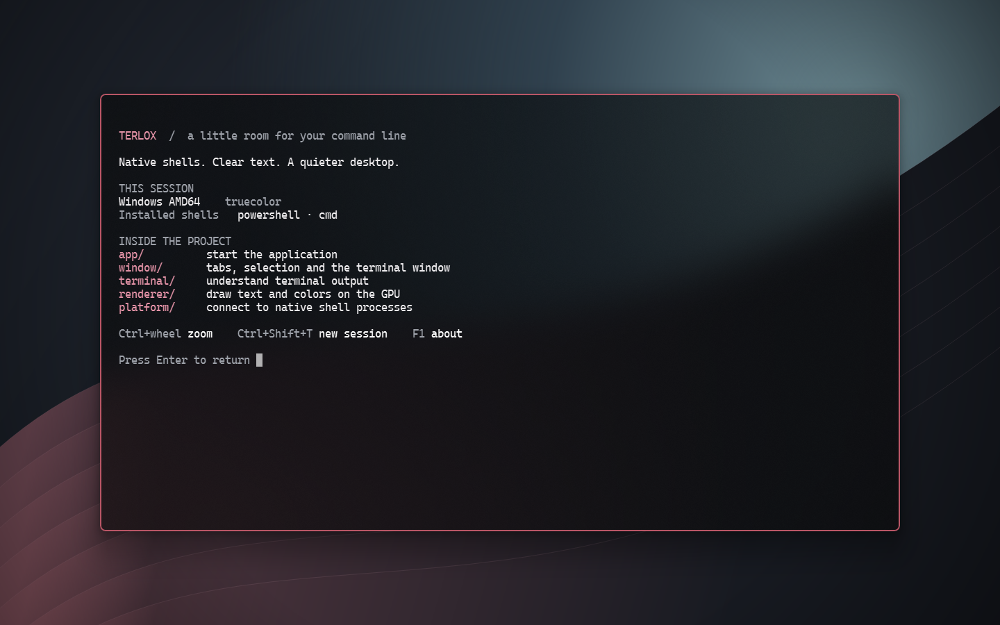

  

<h1 align="center">Terlox</h1>

An open-source, cross-platform terminal with its own shell.

  <a href="docs/getting-started/install.md">Install</a> &nbsp;·&nbsp;
  <a href="docs/README.md">Read the docs</a> &nbsp;·&nbsp;
  <a href="docs/development/code-map.md">Explore the code</a> &nbsp;·&nbsp;
  <a href="CONTRIBUTING.md">Contributing</a> &nbsp;·&nbsp;
  <a href="LICENSE">Apache 2.0</a>

  

## About

Terlox is written in C++ and Qt. It includes `terloxsh`, a separate shell with
its own parser, command execution, history and line editor. It can also run
installed shells such as PowerShell, CMD, Bash, Zsh and Fish.

## Documentation

- [User guides](docs/README.md)
- [Command guide](docs/using/command-guide.md)
- [Code layout](docs/development/code-map.md)
- [Architecture](docs/development/architecture.md)
- [Contributing](CONTRIBUTING.md)
- [Release and update guide](docs/development/releases.md)

## License

Terlox is licensed under **[Apache 2.0](LICENSE)**. Qt, libvterm and Cascadia Mono
keep their own licenses. [Third-party notices](docs/Dependencies.md).
