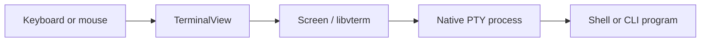
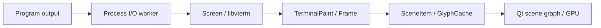

# How the app works

[Docs home](../README.md) · [Code map](code-map.md)

Terlox has three main parts: a shell process executing commands, a screen model
storing terminal output, and a window rendering that screen.
The shell and the graphical app are separate processes.

## Follow a keypress



1. `TerminalInput.cpp` checks whether Terlox owns the action: copy, zoom, About
   and menu commands are examples.
2. Other input goes to `Screen`, where libvterm encodes the appropriate key or
   mouse sequence for the program's current terminal mode.
3. `Session` forwards those bytes to `Process`.
4. The OS delivers them to the shell or CLI program through a pseudo-terminal.

A **pseudo-terminal**, or PTY, is a connection that makes a program behave as if
it has a real terminal: interactive input, resize events and terminal output.
Windows calls its implementation ConPTY; the POSIX backend uses `forkpty`.

## Follow a line of output



Output arrives in chunks, not necessarily whole lines. The process backend reads
those chunks and queues them to the UI thread. `Screen` interprets text and
escape sequences, updating cells, colors, cursor state and history.

`TerminalPaint.cpp` takes the visible cells and builds a `Frame`. The renderer
uses that snapshot to update rectangles, images and glyph nodes. New glyphs are
rasterized with Qt and uploaded as textures; repeated glyphs reuse the cache.
This keeps ordinary redraws from rasterizing the whole terminal every frame.

The GPU draws the scene. The CPU handles process I/O, parsing, layout and initial
glyph rasterization.

## Who owns what?

```text
QApplication
└── Window
    └── tab widget
        └── TerminalView   (one per tab)
            └── Session
                ├── Screen
                └── Process
```

Closing a tab deletes its view and session. The process backend shuts down the
native session and joins its workers before their handles disappear. Only the
UI thread mutates `Screen`; worker threads do not draw directly into widgets.

Windows creates the child suspended, assigns it to a kill-on-close process job,
then resumes it. Separate reader/writer workers keep a full pipe from freezing
input. On POSIX, a poll worker services the PTY and a waiter reaps the child.
The backend resets inherited terminal signals and drains queued output before
announcing that the session exited. The standalone shell also resets its startup
signals so it can wait for child processes reliably. `shell/runtime/TerminalState.cpp`
restores terminal modes and foreground ownership after commands, including failed
or interrupted commands that leave the terminal changed.
Detached processes can outlive the session. Complete shell job control is not
implemented.

## Transparency and window rendering

The terminal surface draws a uniform translucent black tint. The desktop
compositor supplies the windows behind it.
Windows requests a native accent material; macOS requests vibrancy. Linux has
the alpha surface but no desktop-specific blur request in the current backend.

`Window.cpp` paints the surrounding blank strip and margins with the same tint.
`FrameBorder.cpp` draws the rose outline with supersampled corner coverage. It
avoids stacking the tint and outline twice at a partially covered corner.

The font grid uses character advances rounded to device pixels. Baselines and
glyph-texture padding use the same alignment to reduce text filtering.

## History, selection and About

`Screen` keeps the live terminal state; `Scrollback` keeps a bounded number of
older lines. `TerminalScroll` owns the view's position into that history.
Selection is view state, not text inserted into the shell.

The About page uses a separate screen. Opening it does not replace the running
program's screen contents; closing it restores the original view. The real
process can continue producing output in the meantime.

## Native shells and privileges

The graphical terminal starts whichever profile you select. The independent
`terloxsh` interprets its own shell language and routes supported Windows native
syntax to PowerShell/CMD engines. Native shell profiles provide their full
scripting languages and load their configured startup files.

Windows menu actions and the shell's `sudo` command ask the OS to open a separate
elevated app through `runas`, then start native PowerShell or CMD. The included
shell also requests UAC before running a standalone executable whose manifest
requires elevation. It never retries a command based on an error after execution.
Unix runs the installed sudo in the PTY; the menu opens a sudo shell in another
tab. Native terminal echo controls keep password input hidden. No credential
storage or custom consent UI exists.

## What setup copies

The released Windows EXE uses NSIS to embed and unpack the complete runtime into
a temporary folder, then starts the Qt wizard and cleans up after it exits.
The Qt-free launcher in the build tree starts the wizard from a deployed package.
The wizard reads `.terlox-package.json`, validates a file plan, copies
on a worker thread and writes `.terlox-install.json` as its inventory.

Existing owned files are temporarily backed up during an upgrade. A copy failure
restores earlier replacements. Desktop registration happens after file copying;
if it fails, setup says so and keeps the usable application files for a retry.
The optional Windows default-terminal choice calls the same preference backend
as `terloxctl`. Its per-user COM server receives the Windows console handoff,
duplicates the supplied handles and passes an owned `InboundSession` to the
normal session/view path. The ConPTY backend adopts these handles instead of
creating a replacement process. Microsoft supplies the signed console host;
a private MIDL proxy marshals the handoff interfaces. A versioned proxy filename
keeps different release DLLs separate.

The Windows package includes Microsoft's signed OpenConsole/ConPTY runtime and
Terlox's COM receiver. Registration uses an existing Microsoft console provider
when available and supplies the bundled host when it is absent. COM activation
requires the deployed runtime. The handoff interfaces follow Microsoft's
[default-terminal design](https://github.com/microsoft/terminal/blob/main/doc/specs/%23492%20-%20Default%20Terminal/spec.md).

Linux uses the native Debian package manager or a portable AppImage. macOS uses
Apple's Installer `.pkg`. Both packagers include the application's Qt runtime;
they do not ship the cross-platform developer wizard as the OS installer.
